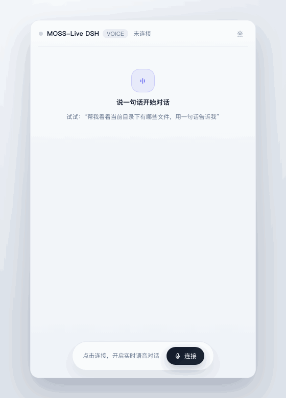

# dsh-moss-live-voice

> 给 [DeepSeek Harness（DSH）](https://github.com/deepseek-ai/deepseek-harness) 加上**实时语音对话**：
> MOSS-Live 负责听和说，复杂任务交给 DSH 自己的 Agent 和工具执行。

> **非官方集成**：本项目与 MOSS、DeepSeek 均无隶属关系，仅调用公开 SDK/接口。
> 使用需要你自己的 MOSS API Key，费用由 MOSS 结算。



<sub>演示使用脚本化数据，界面由插件真实样式表渲染。</sub>

```
 浏览器语音面  ──WS /moss-live/v1──►  DSH host 插件  ──WSS──►  MOSS-Live
  (麦克风/播放/字幕)                   ├ 转发 PCM / 事件         (ASR · TTS · 轮次 · 打断)
                                      └ DshRunner ──► DSH Agent (工具 · 文件 · 代码 · MCP)
```

## 它解决什么

普通语音助手只有"一张嘴 + 一个模型"。这个插件把两层拆开：

| 层 | 谁来做 | 特点 |
|---|---|---|
| **对话层**（听、说、打断、字幕） | MOSS-Live | 全双工、低延迟、可插话 |
| **执行层**（读文件、跑命令、写代码、多步推理） | DSH Agent | 真实工具、沙箱、会话可见、可长期跑 |

MOSS 判断"这活儿要动手"时，通过它的 delegation 协议把任务交给插件；插件把任务变成**一轮 DSH Agent**，
执行过程会上报进度，最终把口语摘要回传给 MOSS 播报；同时 DSH 侧会新建一个可见会话，你可以点开看它调了哪些工具。

## 前置要求

- DSH 已安装并能打开 Web 界面（`dsh web`），版本 `0.2.1-rc.2` 一系（见 `package.json` 的 `engines.dsh`）
- Node.js ≥ 22.19.0
- 你自己的 **MOSS API Key**（在 MOSS 控制台创建）
- 浏览器可访问 `127.0.0.1`（`getUserMedia` 需要安全上下文；远程访问需 HTTPS）

## 快速开始

**1. 安装插件**

```sh
git clone https://github.com/lllkkkai/dsh-moss-live-voice.git ~/dsh-moss-live-voice
```

然后在 DSH 里对 Agent 说一句（或直接调用工具）：

> 把 `~/dsh-moss-live-voice` 装成插件

等价于：

```js
plugin_manager({ action: 'install_bundle', target: '/绝对路径/dsh-moss-live-voice' })
```

> 仓库里已提交预构建的 `index.js`（MOSS SDK 与 `ws` 已内联），**不需要 `npm install`，也不需要 build**。

**2. 填入 API Key**

刷新 DSH 页面 → 左栏底部点「MOSS-Live」→ 右栏面板右上角 ⚙ 设置 → 粘贴 Key → 保存。
密钥只写入本机 `~/.dsh/moss-live.key`（权限 `600`），不会回传浏览器。

也可以用环境变量或自己指定文件：

```sh
printf '%s' 'sk-...' > ~/.dsh/moss-live.key && chmod 600 ~/.dsh/moss-live.key
```

**3. 开始对话**

面板里点「连接」→ 允许麦克风 → 直接说话。

- 闲聊（"今天几号"）：MOSS 直接回答；
- 任务（"帮我看看当前目录下有哪些文件，用一句话告诉我"）：MOSS 说"我去看一下" →
  面板出现「后台 · 执行中」→ 侧边栏多一个「语音：…」会话 → 干完活 MOSS 念出结论。

## 能力

- 实时字幕（用户 / MOSS 双侧，覆盖式更新，流式态半透明）
- 自然打断（`response.audio.stop` → 立即停播并回执 `played_audio_ms`）
- 任务分流：闲聊走 MOSS，动手/长任务走 DSH
- 执行进度播报（静默上下文 + 里程碑朗读两级）
- 对话历史落盘（`~/.dsh/moss-live/history.jsonl`，刷新/重启不丢）
- 本机回环模式：没有 Key 时可以把麦克风音频回放，用来验证音频链路
- 深色 / 浅色主题自适应

## 配置

`cordis.patch.yml` 的 `config`（也可在 profile 的 patch 里覆盖）：

| 字段 | 默认 | 说明 |
|---|---|---|
| `upstream` | 自动 | `true`/`false` 强制开关；省略时有密钥连 MOSS，没有则本地回环 |
| `url` | `wss://api.mosi.cn/v1/realtime` | 上游地址（只接受 WSS / loopback WS） |
| `model` | `moss-live-1.0` | 模型 ID |
| `apiKeyEnv` | `MOSS_API_KEY` | 密钥环境变量名 |
| `apiKeyFile` | — | 密钥文件路径（优先级最高） |
| `user` | — | 稳定的终端用户 ID（可选） |
| `cwd` | `~/dsh-projects/MOSS-Voice` | 语音任务的独立工作区 |
| `preset` | 当前默认 preset | Agent preset |
| `instructions` | 内置人设 | 覆盖 MOSS 前台人设（≤ 16000 字符） |
| `maxConcurrency` | `1` | 语音场景建议串行 |
| `taskDeadlineMs` | `540000` | 任务硬超时，到时取消 DSH turn |
| `loopbackAudio` | `true` | 无上游时回灌 PCM（音频自测） |
| `historyFile` | `~/.dsh/moss-live/history.jsonl` | 历史落盘位置 |
| `debugLog` | — | 调试日志文件路径 |

## 常见问题

**连不上 / 401**：Key 无效或过期；面板会把上游返回的 HTTP 状态码显示出来。

**没有麦克风**：需要 `127.0.0.1` 或 HTTPS；首次使用要授权。

**说了任务但没触发**：MOSS 只在"需要动手"时委派。说清对象，例如
「帮我跑一下 `ls -la`，把结论一句话告诉我」；纯闲聊不会触发。

**费用**：MOSS 按会话计费，空闲挂机会持续消耗；不需要时点「断开」。

**DSH 侧看不到任务**：会话出现在侧边栏「未分组」；插件会把它挂到 `cwd` 对应的 workspace。

## 开发

```
src/host/        宿主源码（路由 / 上游 relay / DshRunner / 进度映射 / 密钥 / 历史）
client.js        浏览器半边（单文件，__ModuleLoader__ 注册，无构建）
index.js         宿主预构建产物（提交进仓库，安装即可用）
scripts/build.mjs  esbuild 打包脚本
test/            node:test 用例（mock React 渲染 + 宿主纯函数）
```

```sh
npm install          # 只有改宿主源码时才需要（esbuild + moss SDK + ws）
npm run build        # 重新生成 index.js
npm test             # 跑测试
```

改了 `client.js` → 刷新页面即可；改了 `src/host/**` → 重新 build 并重装插件（先 remove 再 install）。

## 兼容性与已知限制

- 依赖 DSH 的扩展点（`sidebar.right.pane.tab`、`ctx.sidebarRight`、`ctx.agents` 等），
  DSH 升级可能破坏，`engines.dsh` 声明了当前适配范围。
- MOSS SDK 目前是 `0.1.0`，早期版本，接口可能变化。
- 音频链路对真实服务验证过协议与回执，但**没有浏览器端 E2E 测试**；UI 需要人工验收。
- UI 目前只有中文；仅支持 Web（`dsh.client.platform = web`）。

## 安全

见 [SECURITY.md](./SECURITY.md)：密钥只存本机、接口只回掩码、本地 HTTP 边车全部走 DSH 会话鉴权。

## 许可

[MIT](./LICENSE)。`index.js` 内联了 MIT 许可的 `@mossai/mosslive` 与 `ws`，
其声明见 [THIRD_PARTY_NOTICES.md](./THIRD_PARTY_NOTICES.md)。
